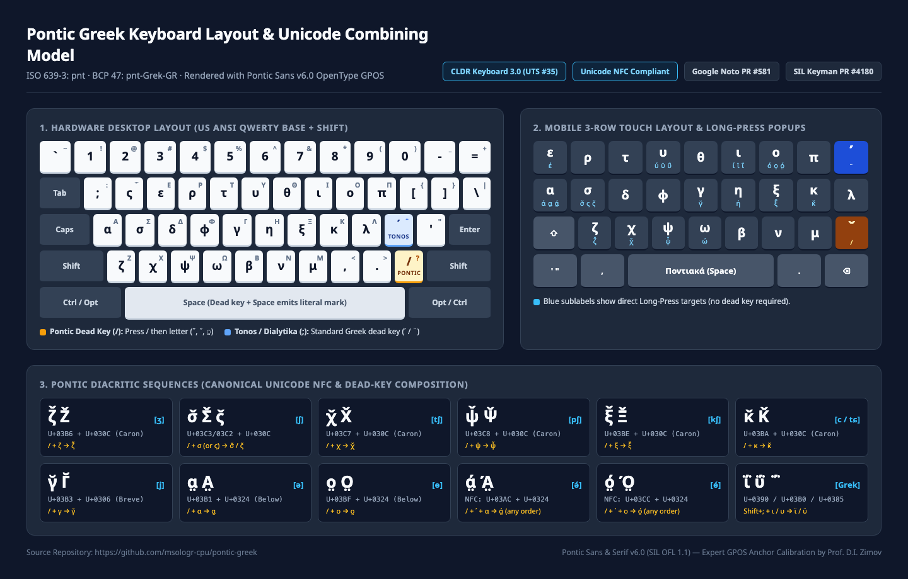

# Pontic Greek (Ποντιακά) Keyboard & Font Suite — Windows / macOS / iOS / Android

> **Current Version (Unified Across All Platforms):** **v6.1** (November 2026)



## Quick Downloads

Latest compiled releases are published on GitHub:
**https://github.com/msologr-cpu/pontic-greek/releases/latest**

### Mobile (iOS / iPadOS / Android) — Keyman
- **SIL Keyman Catalog (Live):** <https://keyman.com/keyboards/pontic_greek> ([`keymanapp/keyboards#4180`](https://github.com/keymanapp/keyboards/pull/4180))
- **Local v6.1 Package:** [`pontic_greek.kmp`](pontic_greek.kmp) / [`keyman/build/pontic_greek.kmp`](keyman/build/pontic_greek.kmp) (includes embedded Pontic Sans v6.0 font)
- **Guide:** [Mobile Installation & Typing Guide (iOS / Android)](docs/MOBILE_GUIDE.md)

### What's New in v6.1 & v6.0
- **v6.1 Mobile Auto-Shift & Caps Lock (Touch):**
  - Tapping Shift on iOS or Android now automatically returns to the lowercase `default` layer immediately after typing a capital letter, implemented cleanly via Keyman 15 `PostKeystroke` (`group(PostKeystroke) readonly`) so uppercase insertion on Android/iOS is 100% reliable.
  - Pending dead keys (`΄`, `ˇ`) keep the Shift layer active until the target uppercase letter is entered.
  - Double-tapping Shift activates the dedicated `caps` lock layer (`*ShiftedLock*`) across phone and tablet layouts, with full post-fix and pre-fix `[SHIFT]` diacritic parity.
- **v6.0 OpenType GPOS Fonts (Merged Upstream in Google Noto):**
  - Calibrated OpenType GPOS top and bottom anchors for caron (`U+030C`), breve (`U+0306`), and diaeresis below (`U+0324`) across all 8 font weights and styles (including italic slope compensation and HarfBuzz verification <= 1 font unit).
  - Upstream fixes merged into Google Noto (`notofonts/latin-greek-cyrillic#581`, resolving `#547`).
- **v5.1 Windows MS Word Protection:**
  - Restores and preserves MS Word smart-quote settings so elision apostrophes (`‘ ’`) remain intact in mixed documents (`PonticWordRestore.exe`).

### macOS
- **Keyboard Driver:** [`pnt-macos-v3.keylayout`](pnt-macos-v3.keylayout) (native XML layout with unified `/` Pontic dead key, `ά̤` / `ό̤` dead-key chains, and full `Cmd+C`/`Cmd+V`/`Cmd+Space` shortcut preservation)
- **Installer Script:** [`install_macos.sh`](install_macos.sh)
- **Guide:** [macOS Installation & Usage Guide](docs/MACOS_GUIDE.md)

### Windows (Portable `.exe` — No Admin Required)
- **`PonticKeyboard_v3.exe`** — Unified Pontic dead key `/` *(recommended)*
- **`PonticKeyboard_v3_3keys.exe`** — Optional 3-key variant (`,` `.` `/`)
- **`PonticWordRestore.exe`** — Restores MS Word AutoCorrect smart quotes if affected by v4.0–5.0
- **Guide:** [Windows Installation & Usage Guide](docs/WINDOWS_GUIDE.md)

### Free Open-Source Fonts (SIL OFL 1.1) — 8 Styles
- **Pontic Sans:** Regular, Italic, Bold, Bold Italic (`font/PonticSans-*.ttf`)
- **Pontic Serif:** Regular, Italic, Bold, Bold Italic (`font/PonticSerif-*.ttf`)
- Linked into standard 4-style font families so bold (`Ctrl/Cmd+B`) and italic (`Ctrl/Cmd+I`) formatting work seamlessly in Microsoft Word, LibreOffice, and browsers.
- **Font Documentation & Showcase:** [`font/README.md`](font/README.md) · [`font_test_v6.html`](font_test_v6.html)

---

## Ecosystem & Standards Submissions

- **Google Noto Fonts:** Merged upstream in [`notofonts/latin-greek-cyrillic#581`](https://github.com/notofonts/latin-greek-cyrillic/pull/581) (Issue [`#547`](https://github.com/notofonts/latin-greek-cyrillic/issues/547)).
- **SIL Keyman:** Published via [`keymanapp/keyboards#4180`](https://github.com/keymanapp/keyboards/pull/4180); v6.1 auto-shift + Caps Lock update prepared in [`keyman/`](keyman/).
- **Unicode / CLDR Submission:** Complete schema-validated dossier (`pnt.xml`, `cldr_keyboard_pnt.xml`, `anchors.json`, fonts) on branch [`unicode-submission`](https://github.com/msologr-cpu/pontic-greek/tree/unicode-submission/unicode).
- **Apple (iOS / macOS System Keyboard Proposal):** Dedicated English bundle prepared on branch `apple-submission/apple`.
- **Technical Overview & Roadmap:** [`Explanation.md`](Explanation.md) · [`docs/DISTRIBUTION_ROADMAP.md`](docs/DISTRIBUTION_ROADMAP.md) · [`cldr/core_proposal/CLDR_CORE_LOCALE_SUBMISSION.md`](cldr/core_proposal/CLDR_CORE_LOCALE_SUBMISSION.md)

---

## Pontic Alphabet & Canonical Unicode Model

All Pontic Greek characters are represented strictly using standard Unicode Greek base characters plus canonical combining diacritical marks (`U+030C`, `U+0306`, `U+0324`, `U+0301`) in Normalization Form C (NFC) — no Private Use Area (PUA) codepoints are used.

### Letters with Diaeresis Below (`U+0324`)

| Uppercase | Lowercase | Pronunciation | Combining Sequence (NFC) | Combining Sequence (NFD) |
|---|---|---|---|---|
| `Α̤` | `α̤` | [ə] / [æ] | `U+0391 U+0324` / `U+03B1 U+0324` | `U+0391 U+0324` / `U+03B1 U+0324` |
| `Ά̤` | `ά̤` | stressed [ə́] / [ǽ] | `U+0386 U+0324` / `U+03AC U+0324` | `U+0391 U+0324 U+0301` / `U+03B1 U+0324 U+0301` |
| `Ο̤` | `ο̤` | [ɵ] | `U+039F U+0324` / `U+03BF U+0324` | `U+039F U+0324` / `U+03BF U+0324` |
| `Ό̤` | `ό̤` | stressed [ɵ́] | `U+038C U+0324` / `U+03CC U+0324` | `U+039F U+0324 U+0301` / `U+03BF U+0324 U+0301` |

### Letters with Caron (`U+030C`) and Breve (`U+0306`)

| Uppercase | Lowercase | Approx. Sound | Combining Sequence (NFC) |
|---|---|---|---|
| `Ζ̌` | `ζ̌` | [ʒ] (*zh*) | `U+0396 U+030C` / `U+03B6 U+030C` |
| `Ξ̌` | `ξ̌` | [kʃ] (*ksh*) | `U+039E U+030C` / `U+03BE U+030C` |
| `Σ̌` | `σ̌` / `ς̌` | [ʃ] (*sh*) | `U+03A3 U+030C` / `U+03C3 U+030C` / `U+03C2 U+030C` |
| `Χ̌` | `χ̌` | [tʃ] (*ch*) | `U+03A7 U+030C` / `U+03C7 U+030C` |
| `Ψ̌` | `ψ̌` | [pʃ] (*psh*) | `U+03A8 U+030C` / `U+03C8 U+030C` |
| `Κ̌` | `κ̌` | [c] / [tɕ] | `U+039A U+030C` / `U+03BA U+030C` |
| `Γ̆` | `γ̆` | [j] | `U+0393 U+0306` / `U+03B3 U+0306` |

## Unified Dead-Key Input Model (Desktop)

1. Press `/` (Pontic dead key) followed by the base letter to output the contextual Pontic form (`/` + Space emits literal `/`).
2. Press `;` followed by a vowel for standard Greek tonos (`ά`, `έ`, `ή`, `ί`, `ό`, `ύ`, `ώ`).
3. Combine `;` + `/` (or `/` + `;`) + `α`/`ο` (or `/` + `ά`/`ό`) to compose stressed vowels with diaeresis below (`ά̤`, `ό̤`, `Ά̤`, `Ό̤`).
4. Press `Shift+;` (`:`) followed by `ι` or `υ` for dialytika (`ϊ`, `ϋ`, `Ϊ`, `Ϋ`).

## Touch Input Model (Mobile)

1. **Long-Press:** Hold any base key (`σ`, `ζ`, `χ`, `κ`, `ξ`, `ψ`, `γ`, `α`, `ο`) to select its Pontic or accented variants directly (`σ` also provides `ς` and `ς̌`).
2. **Dead-Key Composition (Pre-Fix or Post-Fix):** Tap `΄` or long-press `΄` -> `ˇ` before OR after the base letter.
3. **Auto-Shift & Caps Lock:** Single-tap Shift types one capital letter and automatically returns to lowercase; double-tap Shift engages Caps Lock.

## Repository Structure

```
pontic-greek/
├── README.md                        # English project overview (this file)
├── Explanation.md                   # Linguistic & Unicode technical specification
├── keyboard_layout_diagram.png      # Visual hardware & mobile layout diagram
├── pnt-macos-v3.keylayout           # macOS native keyboard layout (current)
├── install_macos.sh                 # macOS installer script
├── pnt-3-rows.yaml                  # iOS/iPadOS 3-row touch specification
├── pnt-longpress.yaml               # Mobile long-press popup mapping
├── pnt-macos.yaml                   # macOS layout specification
├── PonticKeyboard_v3.exe/.ahk       # Windows unified `/` layout
├── PonticKeyboard_v3_3keys.exe/.ahk # Windows optional 3-key variant
├── PonticWordRestore.exe/.ahk       # Windows MS Word smart-quote recovery utility
├── pontic_greek.kmp                 # Compiled Keyman v6.1 multi-platform package
├── keyman/                          # Full Keyman v6.1 source, touch layout & build
├── font/                            # Pontic Sans & Serif v6.0 TTFs + GPOS scripts
├── cldr/                            # Unicode CLDR core locale draft (pnt.xml)
├── docs/                            # English end-user guides & release roadmap
├── font_test_v6.html                # Interactive browser font showcase
└── keyboard_reference*.html         # Printable hardware key mapping reference
```

---

## Documentation Index

- **English Guides:**
  - [macOS Installation & Typing Guide](docs/MACOS_GUIDE.md)
  - [Windows Installation & Typing Guide](docs/WINDOWS_GUIDE.md)
  - [iOS & Android (Keyman) Guide](docs/MOBILE_GUIDE.md)
  - [Font Technical Reference (GPOS & HarfBuzz)](font/README.md)
  - [CLDR Core Locale Submission Dossier](cldr/core_proposal/CLDR_CORE_LOCALE_SUBMISSION.md)
  - [Distribution & Standards Roadmap](docs/DISTRIBUTION_ROADMAP.md)
- **Russian End-User Guides (Preserved for Community Users):**
  - [Инструкция для macOS (RU)](ИНСТРУКЦИЯ.md)
  - [Инструкция для Windows (RU)](ИНСТРУКЦИЯ_WINDOWS.md)
  - [Инструкция для Android и iOS (RU)](ИНСТРУКЦИЯ_ANDROID.md)
  - [План дистрибуции (RU)](ПЛАН_ДИСТРИБУЦИИ.md)

## License

- Keyboard layouts, AutoHotkey scripts, Keyman sources, and documentation: **MIT License** ([`keyman/LICENSE.md`](keyman/LICENSE.md)).
- Pontic Sans and Pontic Serif fonts (derived from Google Noto): **SIL Open Font License 1.1** ([`font/OFL.txt`](font/OFL.txt)).
