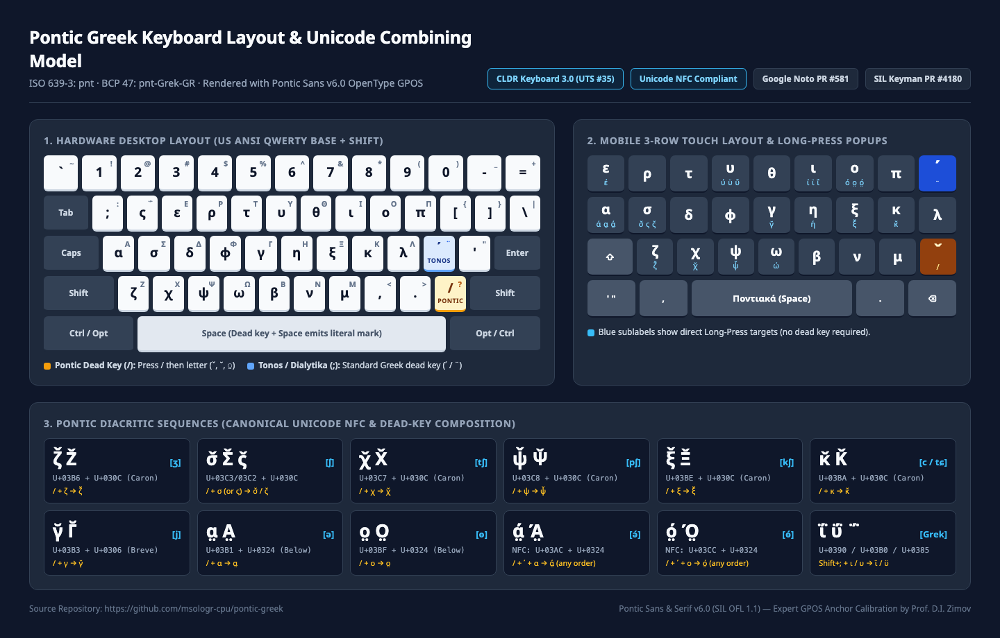

# Pontic Greek (`pnt`, `pnt-Grek`) — Apple iOS, iPadOS & macOS System Keyboard Proposal

**Target Platforms:** iOS / iPadOS (QuickType / Touch Keyboard + Long-Press Popups), macOS (`TIS` Hardware `.keylayout` + Input Source)  
**Locale / BCP 47 Identifier:** `pnt` / `pnt-Grek` / `pnt-Grek-GR` (ISO 639-3: `pnt`, Script: `Grek`, Endonym: **Ποντιακά** / **Ρωμαίικα**)  
**Normalization Standard:** Strictly Unicode NFC Canonical Sequences — zero Private Use Area (PUA) characters  
**Submitter:** Maxim Solomonidi (`msologr@gmail.com`) · Independent Developer / Pontos AI Project  
**Linguistic & Orthographic Authority:** Prof. Dmitry I. Zimov (Author of the 17,000+ entry *Academic Russian-Pontic Dictionary*)  
**Submission Branch:** `https://github.com/msologr-cpu/pontic-greek/tree/apple-submission/apple`  
**Related Industry Acceptance:**
- **Google Noto Fonts:** [`notofonts/latin-greek-cyrillic#581`](https://github.com/notofonts/latin-greek-cyrillic/pull/581) (Merged; resolves OpenType GPOS anchors in Issue `#547`)
- **SIL Keyman:** [`keymanapp/keyboards#4180`](https://github.com/keymanapp/keyboards/pull/4180) (`https://keyman.com/keyboards/pontic_greek`, live in iOS/Android/Desktop Keyman catalog; v6.1 auto-shift + Caps Lock update prepared)
- **Unicode / CLDR Submission:** [`unicode-submission/unicode`](https://github.com/msologr-cpu/pontic-greek/tree/unicode-submission/unicode) (`pnt.xml` DTD-valid + `cldr_keyboard_pnt.xml` XSD-valid UTS #35 Part 7)



---

## 1. Purpose & Request Summary

This submission package provides a complete, drop-in engineering specification and reference implementation for adding native **Pontic Greek** (`pnt`, Greek script `Grek`) input support across Apple platforms:

1. **macOS Hardware Keyboard Input Source** ([`macos/PonticGreek.keylayout`](macos/PonticGreek.keylayout)): Built directly over Apple's Modern Greek QWERTY layout (`Q` = `ς`, `;` = tonos dead key), adding a single unified `/` **Pontic Dead Key**, preserving all Command shortcuts (`Cmd+C`, `Cmd+V`, `Cmd+X`, `Cmd+A`, `Cmd+Z`), and preserving standard apostrophe (`'`) for Pontic elision (`τ' εμόν`).
2. **iOS / iPadOS Touch Keyboard Specification** ([`ios/ios_touch_layout.json`](ios/ios_touch_layout.json), [`ios/PonticTouchLayout_KeymanRef.json`](ios/PonticTouchLayout_KeymanRef.json), [`ios/pnt-3-rows.yaml`](ios/pnt-3-rows.yaml), [`ios/pnt-longpress.yaml`](ios/pnt-longpress.yaml)): Standard 3-row Modern Greek key grid augmented with intuitive long-press popups, standard single-tap Shift auto-return (`shift -> default`), double-tap Shift sticky Caps Lock, and pre-fix/post-fix diacritic support.
3. **System Font OpenType `GPOS` Anchor Reference** ([`fonts/anchors.json`](fonts/anchors.json) + 8 OFL 1.1 [`fonts/`](fonts/) TTFs): Exact `MarkToBase` coordinates calibrated with HarfBuzz (`<= 1` font unit tolerance) so Apple system fonts (San Francisco / SF Pro, New York, Helvetica Neue, Times) can position `U+030C`, `U+0306`, and `U+0324` cleanly over Greek glyphs without overlaps or missing-anchor shifts.
4. **CLDR Alignment & QA Suite** ([`unicode_cldr/`](unicode_cldr/), [`QA_TEST_CORPUS.txt`](QA_TEST_CORPUS.txt)): Canonical NFC/NFD sequences, DTD/XSD-validated CLDR references, and reproducible input/rendering tests.

Pontic Greek has **~778,000 speakers worldwide** (*Ethnologue*, 21st ed.; **400,000** in Greece), an estimated **2.0–2.5 million** global heritage diaspora across Greece, Germany, the United States, Russia, Australia, Georgia, and Kazakhstan, and is classified as **Definitely Endangered** by UNESCO. Native iOS and macOS support removes the main technical barrier preventing younger diaspora speakers from writing Pontic digitally in standard Apple apps (Messages, Mail, Notes, Pages, Safari).

---

## 2. Complete Pontic Character Repertoire (Strict Unicode NFC)

Every Pontic character uses standard Greek base codepoints (`U+0391–U+03C9`) paired with standard Unicode combining marks:
- **Combining Caron:** `U+030C` (`ccc=230`)
- **Combining Breve:** `U+0306` (`ccc=230`)
- **Combining Diaeresis Below:** `U+0324` (`ccc=220`)
- **Combining Acute / Tonos:** `U+0301` (`ccc=230`, composes in NFC to precomposed `ά`/`ό`/`Ά`/`Ό`)

| Lowercase | Uppercase | Base + Combining Marks (NFC) | Canonical NFD | Approx. IPA |
|---|---|---|---|---|
| `ζ̌` | `Ζ̌` | `U+03B6 U+030C` / `U+0396 U+030C` | `U+03B6 U+030C` / `U+0396 U+030C` | `[ʒ]` |
| `σ̌` | `Σ̌` | `U+03C3 U+030C` / `U+03A3 U+030C` | `U+03C3 U+030C` / `U+03A3 U+030C` | `[ʃ]` |
| `ς̌` | — | `U+03C2 U+030C` | `U+03C2 U+030C` | `[ʃ]` (word-final) |
| `χ̌` | `Χ̌` | `U+03C7 U+030C` / `U+03A7 U+030C` | `U+03C7 U+030C` / `U+03A7 U+030C` | `[tʃ]` |
| `ξ̌` | `Ξ̌` | `U+03BE U+030C` / `U+039E U+030C` | `U+03BE U+030C` / `U+039E U+030C` | `[kʃ]` |
| `ψ̌` | `Ψ̌` | `U+03C8 U+030C` / `U+03A8 U+030C` | `U+03C8 U+030C` / `U+03A8 U+030C` | `[pʃ]` |
| `κ̌` | `Κ̌` | `U+03BA U+030C` / `U+039A U+030C` | `U+03BA U+030C` / `U+039A U+030C` | `[c]` / `[tɕ]` |
| `γ̆` | `Γ̆` | `U+03B3 U+0306` / `U+0393 U+0306` | `U+03B3 U+0306` / `U+0393 U+0306` | `[j]` |
| `α̤` | `Α̤` | `U+03B1 U+0324` / `U+0391 U+0324` | `U+03B1 U+0324` / `U+0391 U+0324` | `[ə]` / `[æ]` |
| `ο̤` | `Ο̤` | `U+03BF U+0324` / `U+039F U+0324` | `U+03BF U+0324` / `U+039F U+0324` | `[ɵ]` |
| `ά̤` | `Ά̤` | `U+03AC U+0324` / `U+0386 U+0324` | `U+03B1 U+0324 U+0301` / `U+0391 U+0324 U+0301` | `[ə́]` / `[ǽ]` |
| `ό̤` | `Ό̤` | `U+03CC U+0324` / `U+038C U+0324` | `U+03BF U+0324 U+0301` / `U+039F U+0324 U+0301` | `[ɵ́]` |

*Canonical Ordering Note:* For `ά̤` and `ό̤` (and uppercase `Ά̤` and `Ό̤`), macOS `.keylayout` and Keyman/iOS emit the single precomposed tonos vowel followed by `U+0324` (`U+03AC U+0324`), which is strictly normalized in NFC and matches `U+03B1 + U+0324 + U+0301` under Unicode canonical equivalence.

---

## 3. macOS Hardware Keyboard Specification ([`macos/PonticGreek.keylayout`](macos/PonticGreek.keylayout))

Tested on macOS Sonoma, Sequoia, and Tahoe (Apple Silicon & Intel). Installs directly into `~/Library/Keyboard Layouts/` for immediate internal Apple evaluation.

- **Layout Base:** Standard US ANSI QWERTY Greek mapping (`Q` = `ς`, `Shift+W` = `΅`, `;` = tonos `΄`, `Shift+;` = `:`).
- **Unified `/` Pontic Dead Key (`state="pontic"`):**
  - `/` + `{ζ, σ, ς, χ, ξ, ψ, κ}` (or uppercase) → appends `U+030C`
  - `/` + `{γ, Γ}` → appends `U+0306`
  - `/` + `{α, ο, Α, Ο}` → appends `U+0324`
  - `/` + `Space` → emits literal `/ ` (and dead-key cancel terminators preserve `/`)
  - `/` + non-Pontic consonant/vowel → passthrough `/<letter>` (no lost keystrokes)
- **Bi-Directional Compound State (`state="tonos-pontic"`):**
  - `;` followed by `/`, **or** `/` followed by `;`, followed by `α` / `ο` / `Α` / `Ο` emits canonical NFC `ά̤` / `ό̤` / `Ά̤` / `Ό̤`.
- **macOS System Integrity:** Dedicated Command (`index=4`) and Command+Shift (`index=5`) Latin QWERTY keymaps ensure `Cmd+C`, `Cmd+V`, `Cmd+X`, `Cmd+A`, `Cmd+Z`, `Cmd+Shift+Z`, and Spotlight shortcuts behave natively regardless of active script.
- **Standard Apple Option (`Option`) Map:** Includes `Option+ε` → `€`, `Option+α` → `…`, `Option+ι` → `“`, `Option+ο` → `„`, `Option+,` → `«`, `Option+.` → `»`, `Option+Space` → `U+00A0`.

---

## 4. iOS & iPadOS Touch Keyboard Specification ([`ios/`](ios/))

Designed to integrate seamlessly with Apple's native iOS Greek keyboard geometry (no extra top row, standard thumb-zone spacing, and standard iOS punctuation):

- **Long-Press Popups (`UIKeyboard` Alternate Keys):**
  - `σ` → `[σ̌, ς, ς̌]` · `ς` → `[ς̌]` · `ζ` → `[ζ̌]` · `χ` → `[χ̌]` · `κ` → `[κ̌]` · `ξ` → `[ξ̌]` · `ψ` → `[ψ̌]` · `γ` → `[γ̆]`
  - `α` → `[ά, α̤, ά̤]` · `ο` → `[ό, ο̤, ό̤]`
  - `ε` → `[έ]` · `η` → `[ή]` · `ι` → `[ί, ϊ, ΐ]` · `υ` → `[ύ, ϋ, ΰ]` · `ω` → `[ώ]`
  - Uppercase long-press variants mirror lowercase identically (`Σ̌`, `Ζ̌`, `Χ̌`, `Κ̌`, `Ξ̌`, `Ψ̌`, `Γ̆`, `Ά`, `Α̤`, `Ά̤`, `Ό`, `Ο̤`, `Ό̤`, etc.).
- **Shift & Caps Lock Behavior (Standard iOS UX):**
  - Single-tap Shift enters `shift` layer; typing any uppercase character or selecting a long-press uppercase variant automatically returns to `default` (lowercase).
  - Double-tap Shift locks into `caps` layer until tapped again.
  - Pre-fix dead keys (`΄` / `ˇ`) hold `shift` active until the uppercase base letter completes.
- **Bottom-Row Elision & Punctuation:** Dedicated visible `,`, `'`, and `.` keys keep apostrophes immediately accessible for frequent Pontic elisions (`τ' εμόν`, `κ' εμόν`, `σ' αούτο`).

---

## 5. System Typography / GPOS Requirements for Apple Fonts ([`fonts/`](fonts/))

Even with an identical NFC keyboard layout, correct visual rendering on macOS (`CoreText`) and iOS depends on `GPOS` `MarkToBase` anchors inside system fonts:

1. **Missing Top Anchors on Greek Letters (`U+030C`, `U+0306`):** Historically, fonts only attached `U+030C` to Latin letters (`č, š, ž`), omitting Greek `ζ, σ, ς, χ, ξ, ψ, κ, γ` and uppercase `Σ, Ξ, Ψ`. Without a top anchor, `CoreText` places `U+030C` off-center or overlapping strokes.
2. **Optical Centering & Italic Slant:** Asymmetric shapes (`ζ`, `ξ`, `ψ` descenders and loops; curved `σ` / `ς`) require optical horizontal adjustment rather than raw bounding-box midpoints, plus italic slope projection.
3. **Diaeresis Below (`U+0324`) Anchor (`bottom`):** Requires clean vertical clearance under `α`, `ο`, `ά`, `ό`, `Α`, `Ο`, `Ά`, `Ό` without colliding with `gPOS` base contours.

Exact reference anchor tables (`anchors.json`) and 8 compiled SIL OFL 1.1 test fonts (`Pontic Sans` & `Pontic Serif`, Regular / Italic / Bold / Bold Italic v6.0) are included in [`fonts/`](fonts/) so Apple typography teams can inspect and reproduce the exact optical calibration already merged into Google Noto (`notofonts/latin-greek-cyrillic#581`).

---

## 6. Package Contents

```
apple/
├── README.md                          # This Apple technical specification
├── keyboard_layout_diagram.png        # High-resolution layout & NFC combining diagram
├── QA_TEST_CORPUS.txt                 # Reproducible NFC, dead-key, auto-shift & QA corpus
├── macos/
│   └── PonticGreek.keylayout          # Ready-to-test macOS hardware keyboard layout
├── ios/
│   ├── ios_touch_layout.json          # Structured iOS/iPadOS touch layout specification
│   ├── PonticTouchLayout_KeymanRef.json # Verified v6.1 production Keyman touch layout
│   ├── pnt-3-rows.yaml                # 3-row phone/tablet YAML specification
│   └── pnt-longpress.yaml             # Popup alternate-key map
├── fonts/
│   ├── anchors.json                   # Calibrated GPOS anchor coordinates (English notes)
│   ├── OFL.txt                        # SIL Open Font License 1.1
│   ├── PonticSans-{Regular,Italic,Bold,BoldItalic}.ttf
│   └── PonticSerif-{Regular,Italic,Bold,BoldItalic}.ttf
└── unicode_cldr/
    ├── pnt.xml                        # DTD-validated CLDR Core Locale draft
    └── cldr_keyboard_pnt.xml          # XSD-validated CLDR Keyboard 3.0 XML (UTS #35 Part 7)
```
