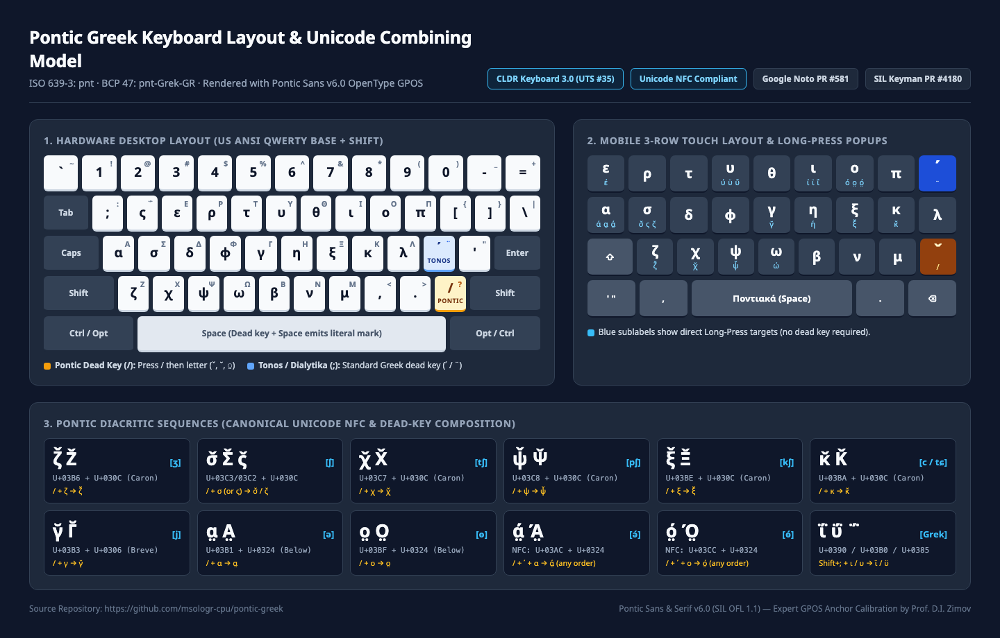

# Technical Specification: Pontic Greek for Unicode and CLDR
## Character Repertoire, Canonical Encodings, OpenType GPOS Fonts, and Core Locale Parameters

**Language:** Pontic Greek (ISO 639-3: `pnt`, BCP 47: `pnt-Grek`)  
**Script:** Greek (`Grek`, ISO 15924: 200)  
**Default Locale / Subtag:** `pnt-Grek-GR` (`pnt_Grek_GR`, time cycle: `h` preferred / `H` allowed)  
**Submitter:** Maxim Solomonidi (<msologr@gmail.com>), Independent Developer / Pontos AI Project  
**Linguistic Expertise:** Prof. Dmitry I. Zimov (Author of the Academic Russian-Pontic Dictionary)  
**GitHub (Unicode Branch):** <https://github.com/msologr-cpu/pontic-greek/tree/unicode-submission/unicode>  
**GitHub (Main Repository):** <https://github.com/msologr-cpu/pontic-greek>  
**Industry Acceptance:** Officially merged in **Google Noto Fonts** ([PR #581](https://github.com/notofonts/latin-greek-cyrillic/pull/581), Issue #547 closed), published in **SIL Keyman** ([PR #4180](https://github.com/keymanapp/keyboards/pull/4180)), and delivered to **Yandex**.

---

## 1. Character Repertoire & Unicode Codepoint Mapping (NFC / NFD)

Pontic Greek uses the 24 standard Greek alphabet letters augmented with canonical Unicode combining diacritical marks (`U+030C`, `U+0306`, `U+0324`, `U+0301`). No new precomposed codepoints are requested; all sequences conform strictly to Unicode Normalization Form C (NFC) and Canonical Ordering.

| Character | Uppercase | Phonetic Value | Unicode NFC Sequence | Canonical NFD Sequence |
|---|---|---|---|---|
| `ζ̌` | `Ζ̌` | Voiced postalveolar fricative [ʒ] | `U+03B6 U+030C` / `U+0396 U+030C` | `U+03B6 U+030C` / `U+0396 U+030C` |
| `σ̌` | `Σ̌` | Voiceless postalveolar fricative [ʃ] | `U+03C3 U+030C` / `U+03A3 U+030C` | `U+03C3 U+030C` / `U+03A3 U+030C` |
| `ς̌` | — | Voiceless postalveolar fricative (final) [ʃ] | `U+03C2 U+030C` | `U+03C2 U+030C` |
| `χ̌` | `Χ̌` | Voiceless postalveolar affricate [tʃ] | `U+03C7 U+030C` / `U+03A7 U+030C` | `U+03C7 U+030C` / `U+03A7 U+030C` |
| `ψ̌` | `Ψ̌` | Postalveolar cluster [pʃ] | `U+03C8 U+030C` / `U+03A8 U+030C` | `U+03C8 U+030C` / `U+03A8 U+030C` |
| `ξ̌` | `Ξ̌` | Postalveolar cluster [kʃ] | `U+03BE U+030C` / `U+039E U+030C` | `U+03BE U+030C` / `U+039E U+030C` |
| `κ̌` | `Κ̌` | Palatal affricate / stop [c]/[tɕ] | `U+03BA U+030C` / `U+039A U+030C` | `U+03BA U+030C` / `U+039A U+030C` |
| `γ̆` | `Γ̆` | Palatal approximant [j] | `U+03B3 U+0306` / `U+0393 U+0306` | `U+03B3 U+0306` / `U+0393 U+0306` |
| `α̤` | `Α̤` | Reduced central vowel [ə]/[ɐ] | `U+03B1 U+0324` / `U+0391 U+0324` | `U+03B1 U+0324` / `U+0391 U+0324` |
| `ο̤` | `Ο̤` | Reduced back vowel [ɵ] | `U+03BF U+0324` / `U+039F U+0324` | `U+03BF U+0324` / `U+039F U+0324` |
| `ά̤` | `Ά̤` | Stressed reduced central vowel [ə́] | `U+03AC U+0324` / `U+0386 U+0324` | `U+03B1 U+0324 U+0301` / `U+0391 U+0324 U+0301` |
| `ό̤` | `Ό̤` | Stressed reduced back vowel [ɵ́] | `U+03CC U+0324` / `U+038C U+0324` | `U+03BF U+0324 U+0301` / `U+039F U+0324 U+0301` |

*Note on double diacritics:* Under Unicode Canonical Ordering, `U+0324` (Combining Diaeresis Below, `ccc=220`) precedes `U+0301` (Combining Acute / Tonos, `ccc=230`) in NFD; in NFC, `U+03B1`/`U+03BF` + `U+0301` compose across `U+0324` to precomposed `ά` (`U+03AC`) / `ό` (`U+03CC`) + `U+0324`.

---

## 2. CLDR Core Data Summary (`cldr.unicode.org/index/cldr-spec/core-data-for-new-locales`)

- **Language Identifier:** `pnt` (ISO 639-3 / BCP 47).
- **Default Content Script & Region:** `pnt_Grek_GR` (aligned with existing CLDR `likelySubtags.xml`).
- **Time Cycle in Default Region (`GR`):** `h` (12-hour preferred, `H` allowed; matching CLDR `timeData` for `GR`).
- **Writing Orientation:** Characters `left-to-right`, lines `top-to-bottom`.
- **Demographics (Published Reference Data):**
  - Total speakers (L1+L2): **778,000** (*Ethnologue, 21st ed.*, 2018 snapshot).
  - Greece (`GR`): **400,000** (*Ethnologue*, citing Z. Diakonikolaou 2009 — ~3.7% of population, matching `supplementalData.xml`).
  - Existing CLDR `supplementalData.xml` entries: Russia (`RU`, 0.04% `pnt_Cyrl`), Türkiye (`TR`, 0.0061% `pnt_Latn`).
  - Endangered status: Classified *Definitely Endangered* (*UNESCO Atlas of the World's Languages in Danger*).
- **Four Exemplar Sets (Verified in [`pnt.xml`](pnt.xml), DTD-valid):**
  - `main`: `[α ά {α̤} {ά̤} β γ {γ̆} δ ε έ ζ {ζ̌} η ή θ ι ί ϊ ΐ κ {κ̌} λ μ ν ξ {ξ̌} ο ό {ο̤} {ό̤} π ρ σ ς {σ̌} {ς̌} τ υ ύ ϋ ΰ φ χ {χ̌} ψ {ψ̌} ω ώ]`
  - `auxiliary`: `[ἀἄἂἆἁἅἃἇὰᾶ ἐἔἒἑἕἓὲ ἠἤἢἦἡἥἣἧὴῆ ἰἴἲἶἱἵἳἷὶῖῒῗ ὄὂὃὸ ὐὔὒὖὑὕὓὗὺῦῢῧ ὤὢὦὥὣὧὼῶ]` (matching `el.xml` polytonic)
  - `numbers`: `[\- ‐‑ , . % ‰ + 0 1 2 3 4 5 6 7 8 9]`
  - `punctuation`: `[\- ‐‑ – — , ; \: ! . … ' ’ " « » ( ) \[ \] § @ * / \\ \&]`

---

## 3. Core Locale Parameters (14 Baseline Items Verified by Prof. D.I. Zimov)

| No. | Category | Value for Unicode CLDR / LDML ([`pnt.xml`](pnt.xml)) |
|---|---|---|
| 1 | **Language Name** | Full: `Το ποντεϊκόν η γλώσσα`. Short / Synonyms: `το ρωμαίικον η γλώσσα`, `τα ποντεϊκά`, `τα ρωμαίικα`. |
| 2 | **Script Name** | `Το ελενικόν η γραφή` (Standard Modern Greek: `ελληνική γραφή`). |
| 3 | **Territories (Diaspora)** | `Η Ελλάδα`, `η Ρουσία`, `η Τουρκία`, `η Γερμανία`, `η Αμερική`, `η Αγγλία`. |
| 4 | **12 Calendar Months** | 1. Jan — `ο Καλαντάτρς` 2. Feb — `ο Κούντουρον` 3. Mar — `ο Μάρτς` 4. Apr — `ο Απρίλτς` 5. May — `ο Καλομηνάς` 6. Jun — `ο Κερασινόν` 7. Jul — `ο Χορτοθέρτς` 8. Aug — `ο Αλωνάρτς`, `ο Αύγουστον` 9. Sep — `ο Σταυρίτες` 10. Oct — `ο Τρυγομηνάς` 11. Nov — `ο Αεργίτες`, `ο Αγιωργίτες` 12. Dec — `ο Χριστιαννάρτς`, `ο Χριστιεννάρτς` |
| 5 | **7 Days of the Week** | Monday — `η Δευτέρα` Tuesday — `η Τρίτ’` Wednesday — `η Τετράδ` Thursday — `η Πέφτ’` Friday — `η Παρασ̌κευή` Saturday — `η Σάββα` Sunday — `η Κερεκή` |
| 6 | **Day Periods (AM / PM)** | `πριν το μεσημέρ` / `μετά το μεσημέρ` |
| 7 | **Date & Time Formats** | Date: `11 τι (τη) Τρυγομηνά 2026` Time: `16:57` |
| 8 | **Date Intervals ("from ... to ...")** | `ας … ους` (Example: `ας 11 ους 15 Τρυγομηνά`) |
| 9 | **Time Zones** | Same as Modern Greek: `Ώρα ({0})`, `GMT+3` |
| 10 | **Number Formatting** | Decimal comma `,`, grouping period `.` (`1.234,56`) |
| 11 | **Number & Currency Patterns** | `12,5 %`, `100,00 €` |
| 12 | **Quotation Marks** | Primary: `« »`, Secondary: `“ ”` |
| 13 | **Measurement System** | Metric (`Μετρικόν σύστεμαν μέτρων`) |
| 14 | **Language Display Pattern** | `{0} ({1})` -> `Ποντεϊκά (Ελλάδα)` or `Ρωμαίικα (Ελλάδα)` |

---

## 4. Font Stack & OpenType GPOS Anchor Calibration

1. **8 Open-Source Typeface Styles:** Pontic Sans and Pontic Serif (Regular, Bold, Italic, Bold Italic) v6.0 under SIL Open Font License 1.1 ([`fonts/`](fonts/)).
2. **Calibrated GPOS Anchors (`mark` / `mkmk`):** Calibrated across 123 glyph entries ([`anchors.json`](anchors.json)) covering upright and true italic styles without diacritic clipping or displacement.
3. **Zero-Collision Double Diacritics:** Stressed reduced vowels (`ά̤`, `ό̤`) attach acute (`top`) and diaeresis below (`bottom`) simultaneously via dedicated GPOS anchor classes.

---

## 5. Package Contents

- [`fonts/`](fonts/) — 8 TrueType fonts (Pontic Sans & Pontic Serif v6.0) with embedded OpenType GPOS tables + [`fonts/OFL.txt`](fonts/OFL.txt).
- [`anchors.json`](anchors.json) — OpenType GPOS master anchor coordinate matrix (123 glyphs, English metadata).
- [`pnt.xml`](pnt.xml) — CLDR LDML locale specification validated against official `common/dtd/ldml.dtd`.
- [`cldr_keyboard_pnt.xml`](cldr_keyboard_pnt.xml) — Official keyboard layout (US ANSI hardware + mobile touch layers) adhering to Unicode CLDR Keyboard Format 3.0 (UTS #35 Part 7), validated against `ldmlKeyboard3.xsd`.
- [`keyboard_layout_diagram.png`](keyboard_layout_diagram.png) — Visual layout and Unicode combining reference rendered with Pontic Sans v6.0.

We are committed to full compliance with Unicode and CLDR review guidelines and are ready to make any adjustments, XML updates, or corrections requested by the committee.
